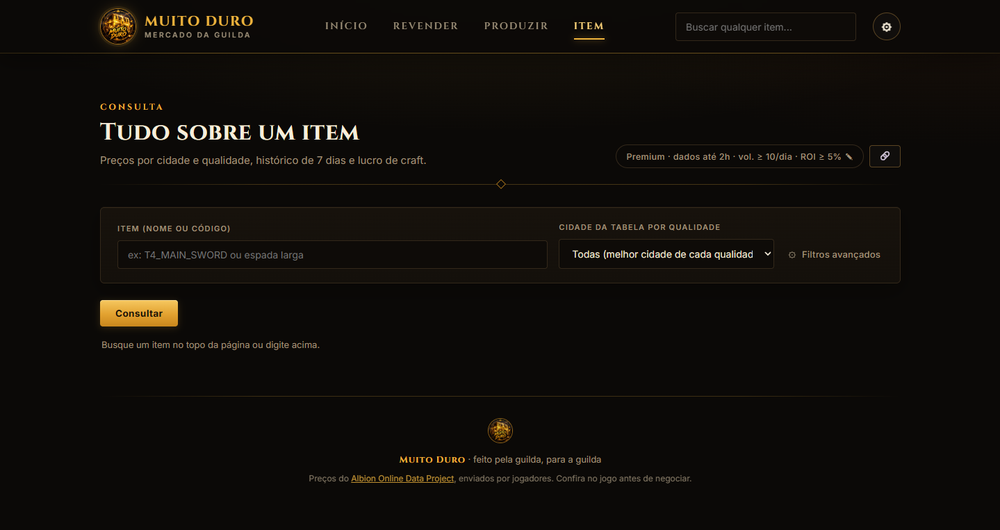

# Game Market Price Analyzer · Albion Online

Site que **consulta, compara e analisa preços do mercado** do jogo online **Albion Online**, para encontrar onde comprar barato, onde vender caro e o que vale a pena produzir.

Ele consome em tempo real a API pública do [Albion Online Data Project](https://www.albion-online-data.com/), cruza os preços de ~12 mil itens em 8 mercados com ~7 mil receitas do jogo e calcula lucro, ROI e risco de cada oportunidade.

> 🔒 **Este repositório é uma vitrine.** O site é de uso privado de uma guilda e o código-fonte fica num repositório privado. **Acesso ao site e ao código sob pedido**: é só entrar em contato.

---

## O que o site faz

| Página | O que responde |
|---|---|
| **Início** | Quais são as melhores oportunidades agora? |
| **Revender** | Onde compro mais barato e vendo mais caro? (entre cidades e entre qualidades do item) |
| **Produzir** | O que dá mais lucro fabricar? Compro os materiais prontos ou fabrico também? |
| **Item** | Quanto vale este item em cada cidade, e como o preço andou nos últimos 7 dias? |

---

## Destaques técnicos

O detalhamento completo, com trechos do código, está em **[DESTAQUES-TECNICOS.md](DESTAQUES-TECNICOS.md)**. Em resumo:

- **Integração com API REST:** requisições em lote dimensionadas pelo limite de tamanho da URL, pool de requisições concorrentes e cancelamento com `AbortController`
- **Limite de requisições (HTTP 429):** retentativa com backoff exponencial (15 s → 30 s → 60 s), pausa automática após erro e atualização automática que respeita a API
- **Cache no navegador:** validade configurável, limite de tamanho com descarte dos mais antigos, cache negativo e correção de um problema de desempenho que travava a página
- **Qualidade dos dados:** descarte de preços fora da curva pela mediana, comparação com a média de 7 dias, filtro de liquidez e de dados velhos
- **Regras de negócio:** impostos, taxas, peso e capacidade de carga, capital disponível e ROI
- **Algoritmo de "comprar ou produzir":** avaliação recursiva da árvore de receitas com memoização e detecção de ciclos
- **Pipeline de dados (ETL) em Node.js:** transforma dumps de ~24 MB em arquivos enxutos, de forma determinística e com relatório de importação
- **Robustez e segurança:** plano B quando o navegador bloqueia arquivos, estado dos filtros na URL, migração de configurações e escape de HTML contra XSS

---

## Tecnologias

**JavaScript (sem framework)** · **HTML** · **CSS** · **Node.js** · **API REST** · **localStorage** · **SVG** · **Cloudflare** · **Git**

Desenvolvido com apoio de IA (**Claude Code**) no fluxo de trabalho: eu defini as regras de negócio, a arquitetura em módulos, os testes contra o jogo e o diagnóstico de problemas.

---

*Albion Online é marca da Sandbox Interactive. Projeto de fã, sem ligação oficial com o jogo.*
